# Screenshot examples: evidence of how we used the technology

What this file is: the evidence the guidebook asks for ("screenshots as evidence of platform capabilities"), organised by the technology we used. Context and conclusions are in [`decisions.md`](decisions.md).

**How each piece of evidence was produced (so nothing is overstated):**
- **Captured** = a screenshot taken for this file, on 2026-10-17, from the running demo (headless Chrome) or from real command output rendered in a terminal-style frame. Files are in [`screenshots/`](screenshots/).
- **VM screenshot** = a real screenshot of the LinuxONE VM's JupyterLab (IBM logo top right), taken by the team on 2026-10-17 evening (files `vm-01` to `vm-12`).
- **VM output (verbatim)** = text the team copied from the LinuxONE VM terminal and pasted into our working session; reproduced exactly below. These are not screenshots.

## Technology map

| Technology | What we used it for | Evidence | Status |
|---|---|---|---|
| **IBM LinuxONE VM (s390x, z17-generation)** | Runs the notebooks (data build, model training, replay) and serves the demo | A0 `lscpu` (z/VM 7.3.0), A1 and screenshot `vm-01`, `vm-03` (33 tests pass on s390x) | VM screenshots |
| **IBM Z AI accelerator (`nnpa`, zDNN) via Snap ML** | Tested for forecaster inference; benchmarked fairly; production stays on CPU | A2, A3 and screenshots `vm-02`, `vm-03` | VM screenshots |
| **LightGBM (Poisson objective)** | Demand forecaster, 8 models | C1 tests; B4 zones shaded by its output; model trained and scored on the VM (`vm-08` to `vm-12`), replayed (`vm-04` to `vm-06`) | Captured |
| **Python replay and routing policy** | Four-policy comparison on real incidents | `vm-04` to `vm-06` (run on the VM); C2 export run; B6 results | Captured |
| **OSRM (open street routing)** | Real street routes for the policy's moves | B3 (dashed navy routes); `vm-07` (OSRM called from the VM) | Captured |
| **React + Leaflet + OpenStreetMap tiles** | The demo | B1-B6 | Captured |
| **Compute / scalability** | Guidebook criterion 3 | `vm-01`, `vm-03` (3 CPUs, 8.2 GB, 1.0 GB peak for two years of data) | Captured |

---

## V. LinuxONE VM screenshots (real, from the team's JupyterLab on the VM)

Taken in the VM's JupyterLab (IBM logo top right). `vm-01` to `vm-03` are in a scratch notebook named `Reponse_Times`; `vm-04` to `vm-12` are in `HarryRowlands`. (The notebook shows "Not Trusted" only because it was opened from a copy; it does not affect the outputs.)

### V1. Platform, accelerator flag, libraries and memory test (`scripts/vm_check.py`)
s390x big-endian, IBM Z type 9175, 3 logical CPUs, 8.4 GB RAM (2.8 GB available at that moment), the `nnpa` AI-accelerator flag, Snap ML installed, TensorFlow 2.18.1, and the pipeline memory test: two years (3,074,985 incidents) → 8.27M-row panel, 3 s, peak 1.0 GB. The cell above the output (`!nproc`, `!head -3 /proc/meminfo`) is the resource check.

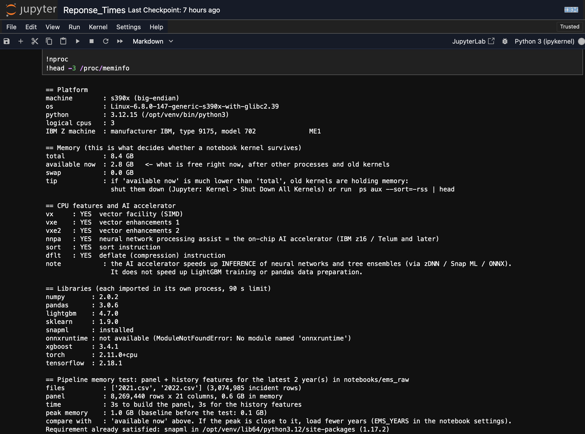

### V2. Accelerator verdict (`scripts/accel_check.py`)
zDNN library found; Snap ML selects the accelerator format (`zdnn_tensors`); for the synthetic numeric model the output matches LightGBM (max difference 2.5e-08) but the accelerator is 0.4× LightGBM's speed; for our real model the predictions do not match (max difference 4.6), so the accelerator is not used.

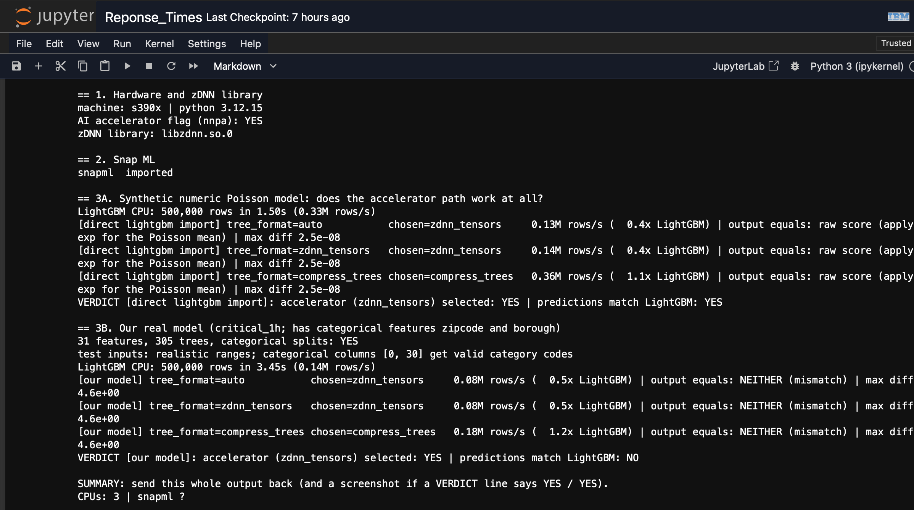

### V3. Fair benchmark, then the test suite and memory on the VM
Accelerator ÷ best LightGBM: 0.56 / 0.45 / 0.34 (15 leaves) and 0.69 / 0.56 / 0.35 (63 leaves) at batch sizes 256 / 4,096 / 100,000: slower in every cell. Below it, pytest is installed and **33 tests pass in 1.61 s on s390x**, then `nproc` = 3 and `/proc/meminfo` (8.2 GB total, 2.7 GB available).

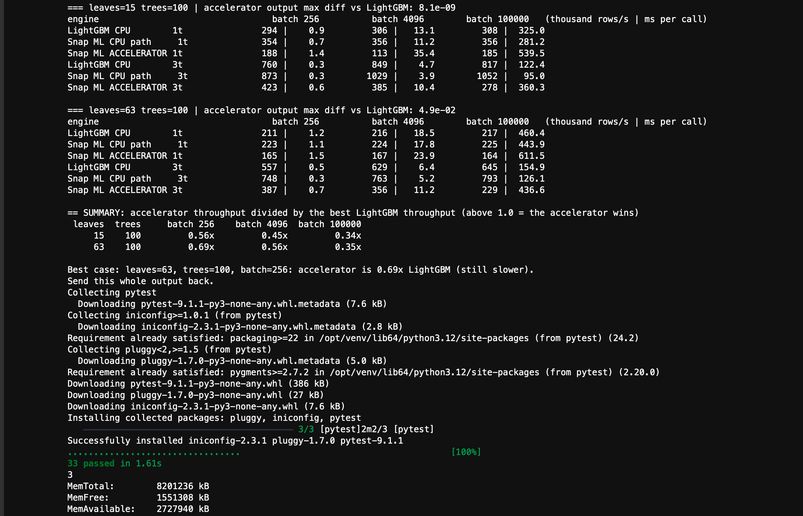

### V4. The replay run on the VM, 2022-07-19 (four policies, 330 units)
Model notebook cells 56-57: the demand sources for the three dynamic policies (4,134,720 test rows each, static layout from 235 ZIPs), then the replay of 4,713 incidents. Critical calls within 8 minutes: static 81.85%, scheduled 91.96%, forecast 91.67%, oracle 93.85%; 90th-percentile 10.47 / 7.56 / 7.70 / 7.28 min; about 2,200 moves a day for each dynamic policy; median decision time about 174 ms per cycle on the VM.

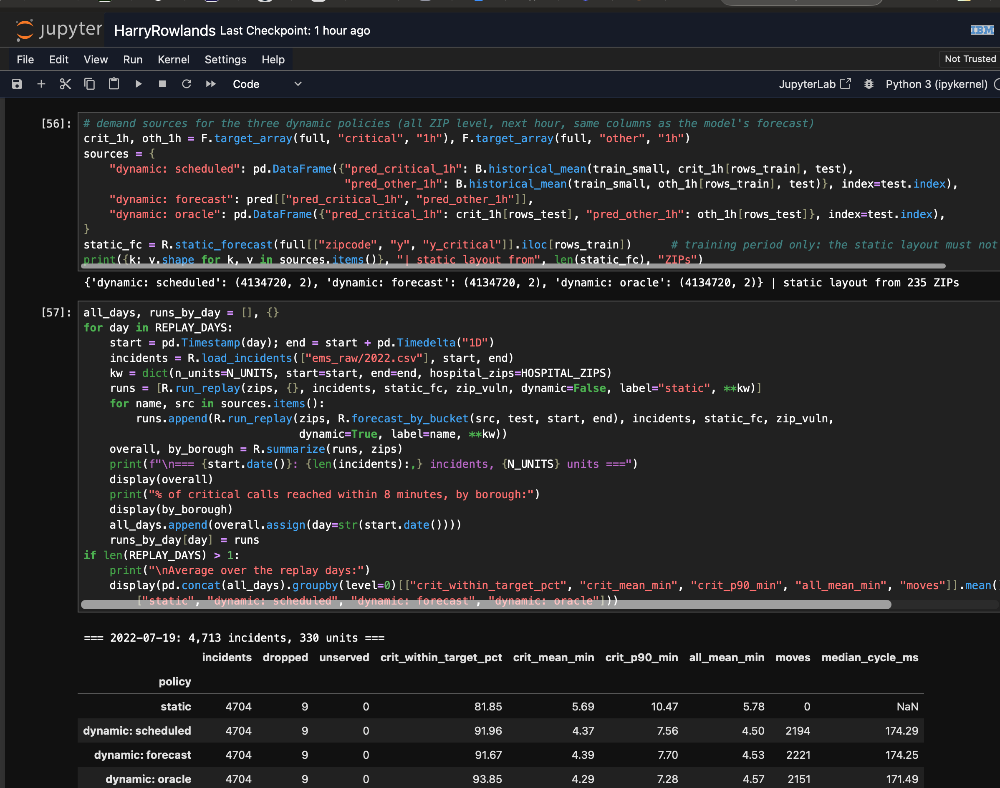

### V5. The second replay day, 2022-10-12, and the two-day average
Static 70.95%, scheduled 78.31%, forecast 77.84%, oracle 78.79%; borough breakdown (Staten Island 58.8% → 63.7%); two-day average: static 76.40%, scheduled 85.14%, forecast 84.76%, oracle 86.32% (90th percentile 17.06 / 12.08 / 11.83 / 12.77 min).

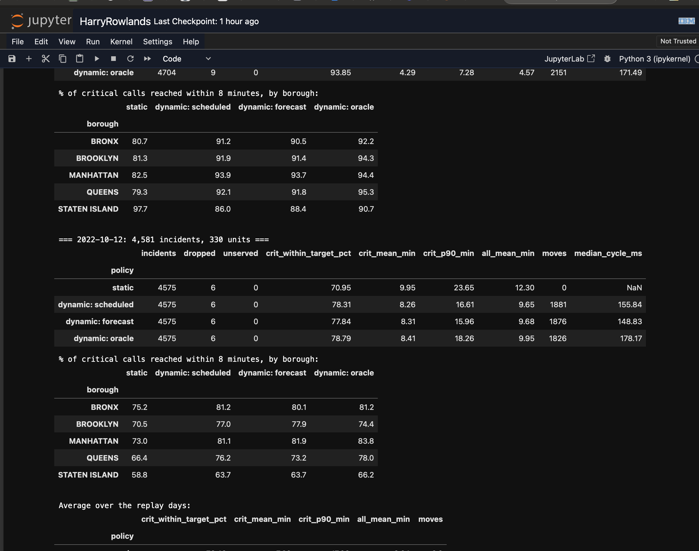

### V6. Fleet-size sensitivity (2022-07-19)
Critical calls within 8 minutes at 300 / 330 / 370 units: static 77.5 / 81.8 / 87.0, scheduled 90.0 / 92.0 / 93.7, forecast 89.6 / 91.7 / 94.4, oracle 90.6 / 93.8 / 94.7. The conclusions depend on the fleet size, which is why we sweep it.

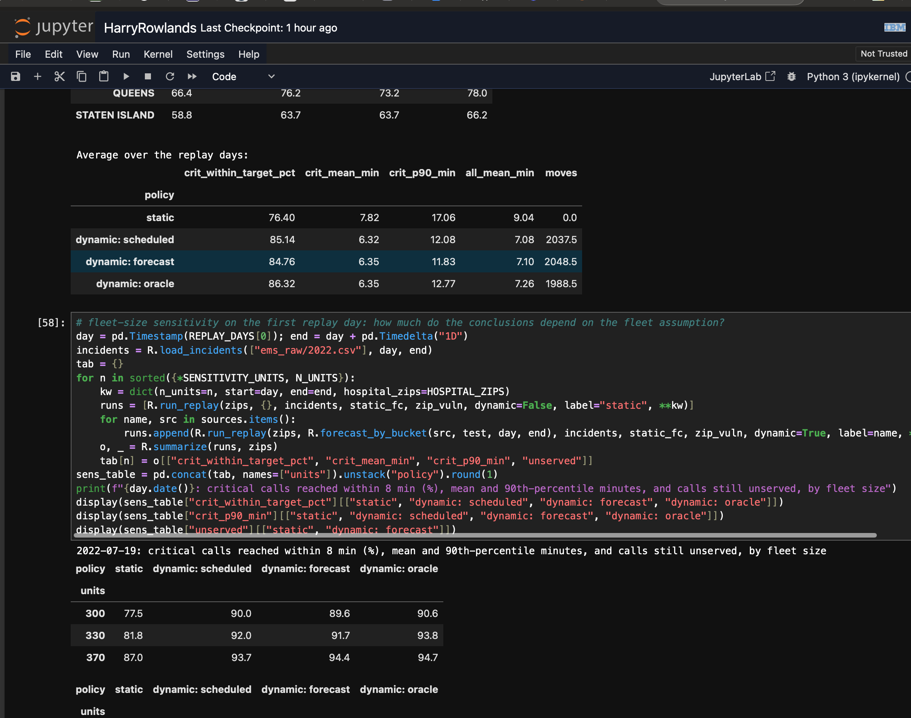

### V7. Real street routes for the model's moves, called from the VM
The VM reaches the public OSRM server: each of the six highest-gain moves gets a real street route and time (`route_source = osrm`); for example unit U126, ZIP 10472 → 10452, 6.6 km by street, about 7 minutes where the policy's placeholder said 13. The placeholder is 30-115% too slow on these moves.

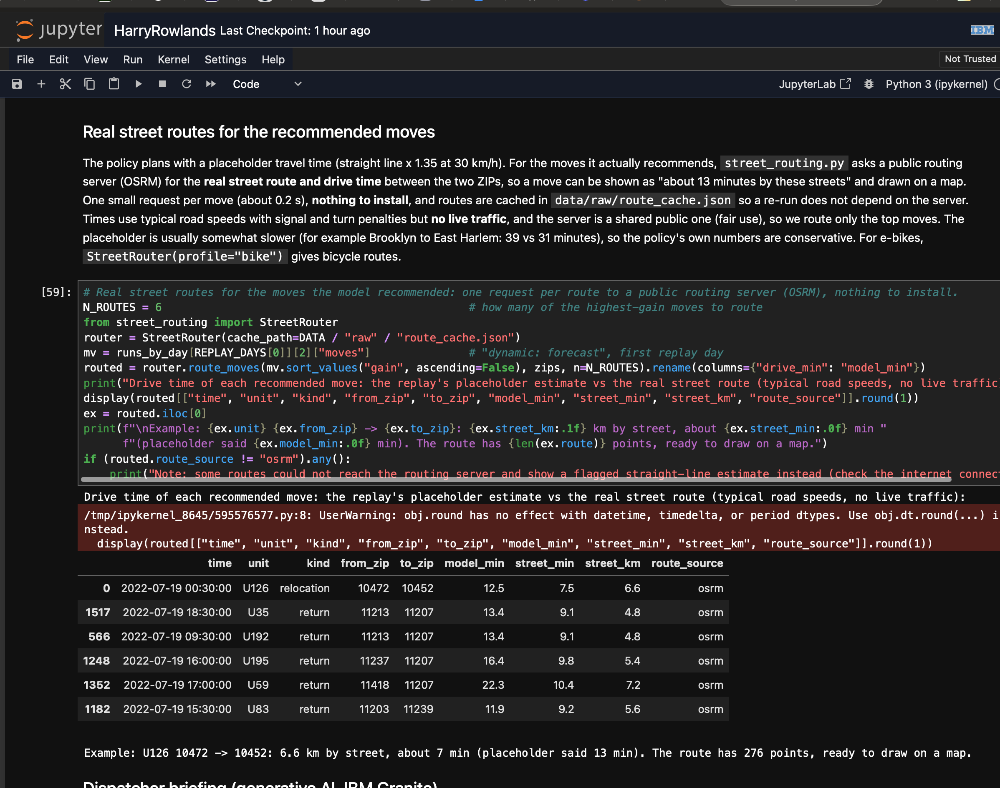

### V8. The forecaster trained on the VM (model notebook cells 6-8)
Eight LightGBM Poisson models fitted, each on 3,091,128 training rows, with the early-stopping iteration chosen on the validation quarter (critical 268 / 305 / 321 / 299 and other 413 / 356 / 403 / 346 for 30 min / 1 h / 2 h / 3 h). The test period is 2022-01-01 to 2022-12-31 (4,134,720 ZIP-half-hours); the model then predicts all of it and the scoring cell compares it with three baselines (historical mean, surge-scaled mean, same window last week) over all rows, heat days, heavy-rain days, the 20 busiest ZIPs and each borough.

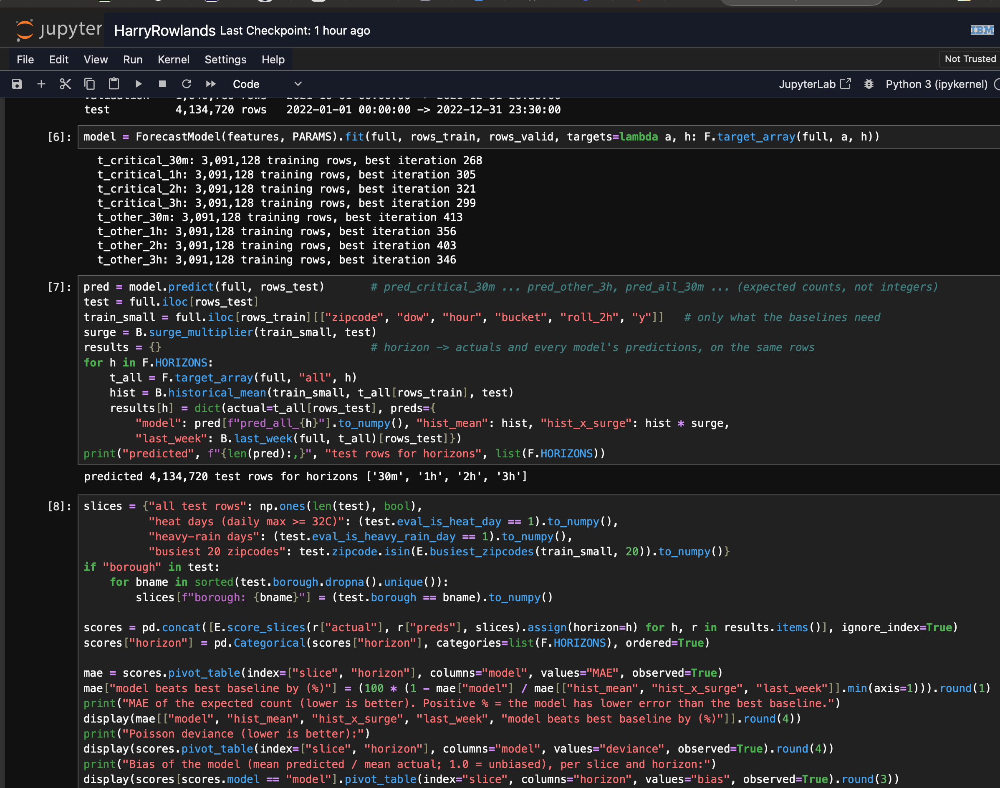

### V9-V10. Error scores (MAE of the expected count), overall and by slice
"Model beats best baseline by (%)": all test rows 0.0 / 0.7 / 1.3 / 1.6 at 30 min / 1 h / 2 h / 3 h (model MAE 0.3914 / 0.5689 / 0.8186 / 1.0161 against the historical mean's 0.3915 / 0.5731 / 0.8295 / 1.0329). By borough the 3-hour gain is Bronx 1.7%, Brooklyn 1.8%, Manhattan 2.2%, Queens 1.0%, Staten Island 1.2%; the model is slightly worse at 30 minutes in Manhattan (-0.3), Queens (-0.5) and Staten Island (-0.3). Busiest 20 ZIPs: +0.9 to +2.1; heat days: -1.2 at 30 min to +2.2 at 3 h; heavy-rain days +0.5 to +1.9. The gains are small, which is the honest finding.

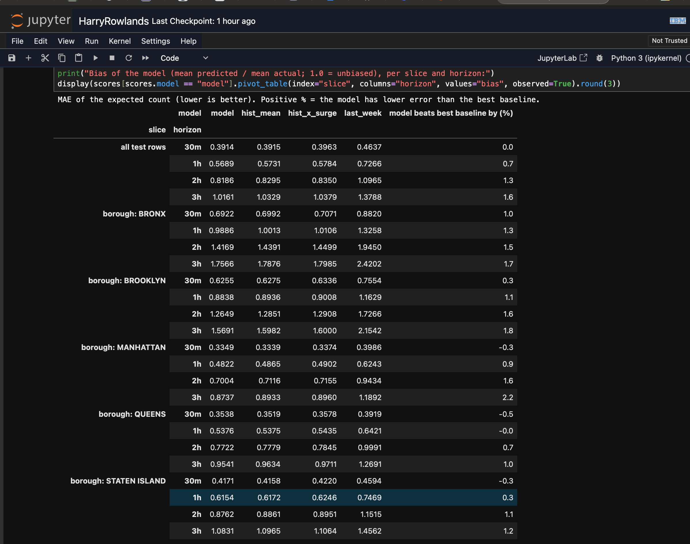
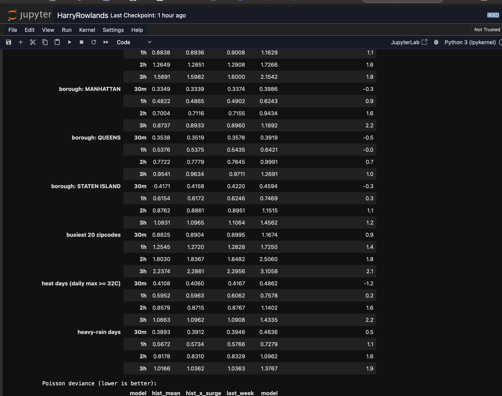

### V11-V12. Poisson deviance and bias
The model has the lowest deviance in every slice at every horizon (all rows 0.6780 / 0.8046 / 0.8872 / 0.9204 against the historical mean's 0.7275 / 0.8545 / 0.9451 / 0.9858 and the surge-scaled mean's 0.7248 / 0.8493 / 0.9352 / 0.9718; last week's value is far worse at 5.4-6.5). On heat days at 3 hours the surge-scaled baseline (0.9831) beats the plain historical mean (1.0368) but not the model (0.9246). Bias (mean predicted ÷ mean actual): 0.961 / 0.961 / 0.958 / 0.958 over all rows, 0.945-0.970 in every slice: the model runs about 4% low on 2022, as documented. The calibration-by-decile output (cell 9) is not in this set.

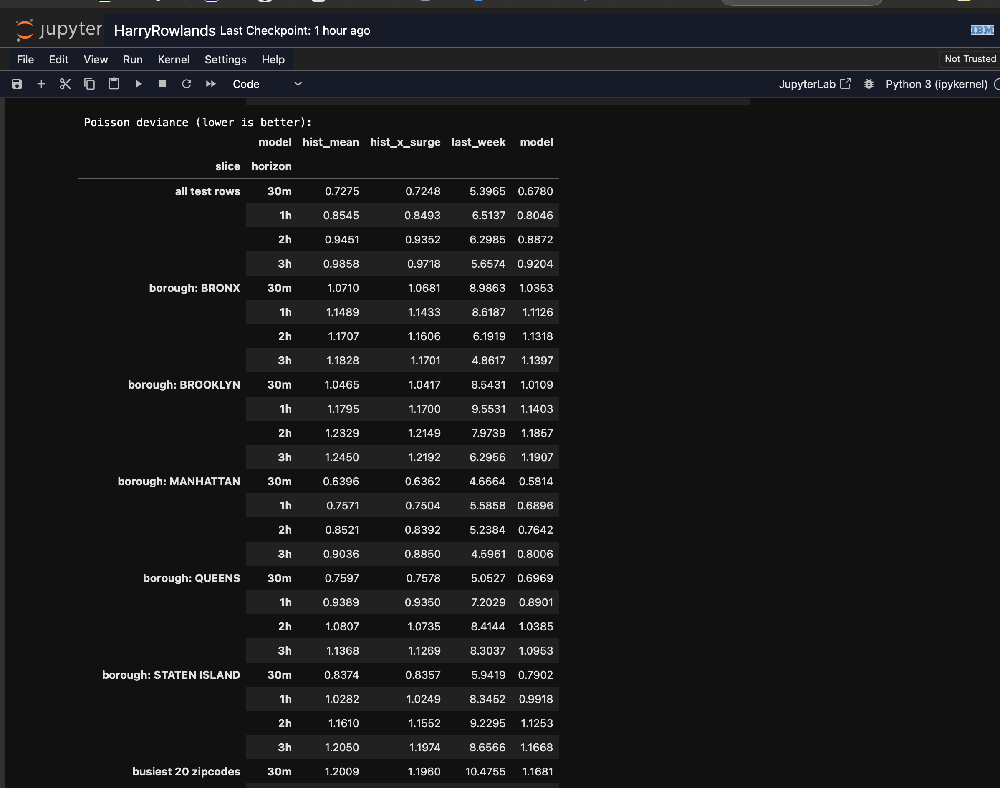
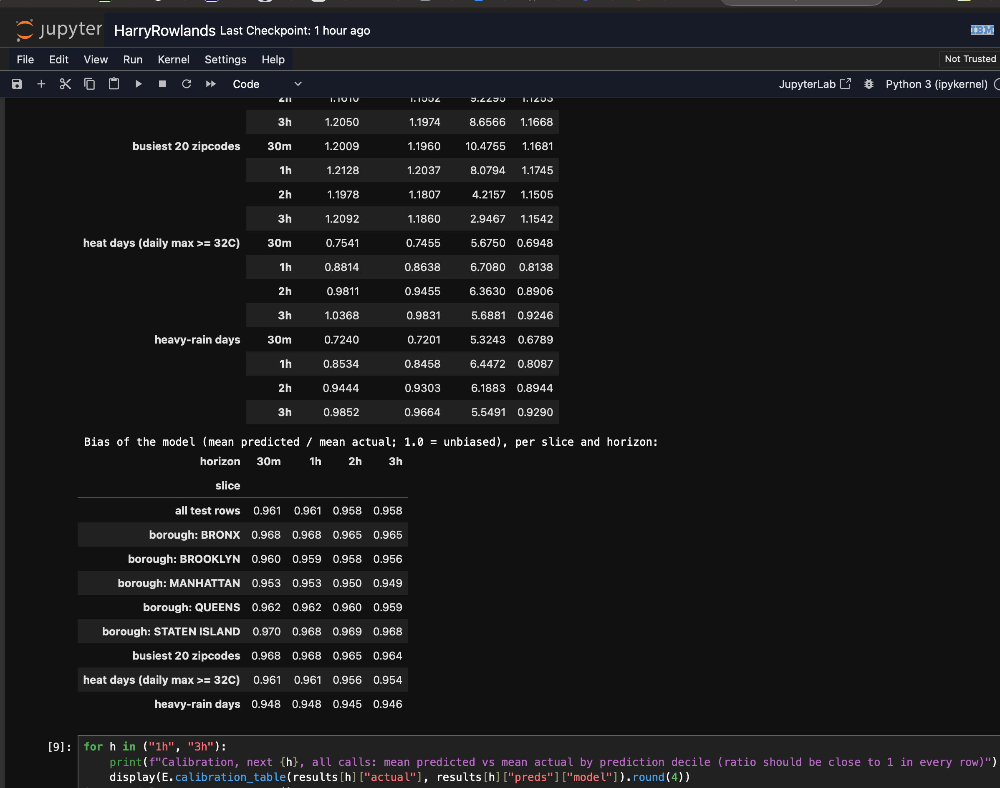

These screenshots reproduce, on the LinuxONE VM, the run-2 numbers recorded in `decisions.md` section 7.

---

## A. LinuxONE VM evidence (verbatim output from the VM)

### A0. `lscpu` (pasted from the VM, current session)
```
s390x
Architecture:                            s390x
CPU op-mode(s):                          32-bit, 64-bit
Byte Order:                              Big Endian
CPU(s):                                  3
Vendor ID:                               IBM/S390
Machine type:                            9175
Thread(s) per core:                      1
Drawer(s):                               3
CPU dynamic MHz:                         5508
Flags:                                   esan3 zarch stfle msa ldisp eimm dfp edat etf3eh highgprs te vx vxd vxe gs vxe2 vxp sort dflt vxp2 nnpa sie
Hypervisor:                              z/VM 7.3.0
Hypervisor vendor:                       IBM
```
(Output trimmed to the lines that matter.) Two sessions appear in our evidence: the earlier terminal prompt was `linux1@grease` (sections A1-A3) and the current JupyterLab session's paths are under `/home/ibm-user/`. Both report the same machine (s390x, type 9175, 3 CPUs, 8.4 GB), so we treat them as the same VM; if they are different instances, say so in the video.

### A1. Platform check (`python3 scripts/vm_check.py --years 2`, earlier session on `linux1@grease`)
Shows the machine is an IBM Z (s390x, big-endian), the memory we have to work within, and that the on-chip AI accelerator flag (`nnpa`) is exposed.

```
== Platform
machine        : s390x (big-endian)
os             : Linux-6.8.0-147-generic-s390x-with-glibc2.39
python         : 3.12.15
logical cpus   : 3
IBM Z machine  : manufacturer IBM, type 9175, model 702              ME1

== Memory (this is what decides whether a notebook kernel survives)
total          : 8.4 GB
available now  : 5.6 GB   <- what is free right now, after other processes and old kernels
swap           : 0.0 GB

== CPU features and AI accelerator
vx     : YES  vector facility (SIMD)
vxe    : YES  vector enhancements 1
vxe2   : YES  vector enhancements 2
nnpa   : YES  neural network processing assist = the on-chip AI accelerator (IBM z16 / Telum and later)
sort   : YES  sort instruction
dflt   : YES  deflate (compression) instruction

== Libraries
numpy       : 2.0.2
pandas      : 3.0.6
lightgbm    : 4.7.0
sklearn     : 1.9.0
snapml      : not available (ModuleNotFoundError)
onnxruntime : not available (ModuleNotFoundError)
xgboost     : 3.4.1
torch       : 2.11.0+cpu
```
(Excerpt: the tip and explanatory lines of the script's output are omitted. In the very first run, from a different Python, the libraries were missing and the pipeline test failed with `No module named 'numpy'`; the notebook environment has them.)

### A2. Accelerator test (`python3 scripts/accel_check.py`)
Snap ML 1.17.2 installed from a PyPI s390x wheel and picked the accelerator format. For a small numeric model the accelerator matches LightGBM; for our real model (categorical features) the predictions do not match, so it cannot be used as is.

```
== 1. Hardware and zDNN library
machine: s390x | python 3.12.15
AI accelerator flag (nnpa): YES
zDNN library: libzdnn.so.0

== 2. Snap ML
snapml  imported

== 3A. Synthetic numeric Poisson model: does the accelerator path work at all?
LightGBM CPU: 500,000 rows in 1.43s (0.35M rows/s)
[direct lightgbm import] tree_format=auto           chosen=zdnn_tensors     0.08M rows/s (  0.2x LightGBM) | output equals: raw score (apply exp for the Poisson mean) | max diff 2.5e-08
[direct lightgbm import] tree_format=zdnn_tensors   chosen=zdnn_tensors     0.08M rows/s (  0.2x LightGBM) | output equals: raw score (apply exp for the Poisson mean) | max diff 2.5e-08
[direct lightgbm import] tree_format=compress_trees chosen=compress_trees   0.12M rows/s (  0.4x LightGBM) | output equals: raw score (apply exp for the Poisson mean) | max diff 2.5e-08
VERDICT [direct lightgbm import]: accelerator (zdnn_tensors) selected: YES | predictions match LightGBM: YES

== 3B. Our real model (critical_1h; has categorical features zipcode and borough)
31 features, 305 trees, categorical splits: YES
test inputs: realistic ranges; categorical columns [0, 30] get valid category codes
LightGBM CPU: 500,000 rows in 10.27s (0.05M rows/s)
[our model] tree_format=auto           chosen=zdnn_tensors     0.05M rows/s (  1.0x LightGBM) | output equals: NEITHER (mismatch) | max diff 4.6e+00
[our model] tree_format=zdnn_tensors   chosen=zdnn_tensors     0.05M rows/s (  1.0x LightGBM) | output equals: NEITHER (mismatch) | max diff 4.6e+00
[our model] tree_format=compress_trees chosen=compress_trees   0.05M rows/s (  1.1x LightGBM) | output equals: NEITHER (mismatch) | max diff 4.6e+00
VERDICT [our model]: accelerator (zdnn_tensors) selected: YES | predictions match LightGBM: NO
```
Earlier attempts on the same VM, kept because they are part of the story: the generic importer rejected LightGBM files (`Generic model import currently supports only 'pmml' as the input type`), and the PMML route through Nyoka failed with `undefined feature used at line 86` and `non-supported value defined for algorithmName attribute`. The working route is the class-level `BoostingMachineRegressor().import_model(file, "lightgbm")`.

### A3. Fair benchmark (`python3 scripts/accel_bench.py --quick`, 3 CPUs, thousand rows per second | milliseconds per call)
All engines at 3 threads in the lower rows (Snap ML defaults to 1 thread, which made the first comparison unfair).

```
=== leaves=15 trees=100 | accelerator output max diff vs LightGBM: 8.1e-09
engine                                 batch 256          batch 4096        batch 100000
LightGBM CPU        1t               299 |    0.9         310 |   12.9         314 |  318.9
Snap ML CPU path     1t              351 |    0.7         352 |   11.4         356 |  281.2
Snap ML ACCELERATOR 1t               188 |    1.4         119 |   33.5         185 |  541.8
LightGBM CPU        3t               773 |    0.3         891 |    4.5         908 |  110.1
Snap ML CPU path     3t              966 |    0.3        1026 |    3.9        1020 |   98.0
Snap ML ACCELERATOR 3t               417 |    0.6         379 |   10.6         239 |  417.6

=== leaves=63 trees=100 | accelerator output max diff vs LightGBM: 4.9e-02
LightGBM CPU        1t               222 |    1.2         226 |   17.7         230 |  434.0
Snap ML CPU path     1t              222 |    1.2         223 |   18.0         223 |  448.2
Snap ML ACCELERATOR 1t               165 |    1.6         167 |   23.9         168 |  596.4
LightGBM CPU        3t               599 |    0.4         652 |    6.1         655 |  152.6
Snap ML CPU path     3t              728 |    0.4         759 |    5.3         783 |  127.7
Snap ML ACCELERATOR 3t               343 |    0.7         345 |   11.6         240 |  417.4

== SUMMARY: accelerator throughput divided by the best LightGBM throughput (above 1.0 = the accelerator wins)
 leaves  trees     batch 256    batch 4096  batch 100000
     15    100         0.54x         0.43x         0.26x
     63    100         0.57x         0.53x         0.37x
Best case: leaves=63, trees=100, batch=256: accelerator is 0.57x LightGBM (still slower).
```
**Conclusion we report:** the accelerator is present, drivable and benchmarked; it was slower than CPU LightGBM (0.26-0.57×) and, for larger trees, slightly less accurate, so production scoring stays on the CPU. We do not claim a speed-up. A live 256-row cycle takes 0.3-0.7 ms on every engine, so inference speed is not a bottleneck.

**Repeat run (screenshot `vm-03`):** the ratios were 0.56 / 0.45 / 0.34 and 0.69 / 0.56 / 0.35, so the best case is 0.69× rather than 0.57×; the conclusion is unchanged.

## B. The demo (captured from the running app)

The look follows the pitch deck: navy, signal red and gold, Oswald headings, flat squares for status.

Every figure is the real replay of 2022-07-19: real incidents, the LightGBM forecast for each half-hour, and the policy's moves. Response times are modelled.

### B1. Compare view at the start of the replay
Static layout (left) and model-guided fleet (right) on the same calls and the same 330 units; zones shaded by the model's risk index.

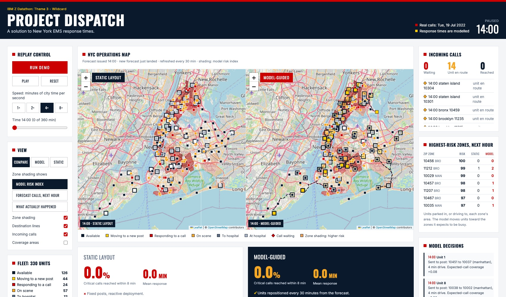

### B2. Mid-replay (16:30): live units, incoming calls, new forecast
Units are flat squares coloured by what each is doing; diamonds are calls (red = no unit assigned yet, amber = a unit is on the way); the right-hand panels show waiting and en-route calls, the highest-risk zones with units parked there (static vs model), and the model's recent decisions. The banner reads "Forecast issued 16:30 · new forecast just landed".

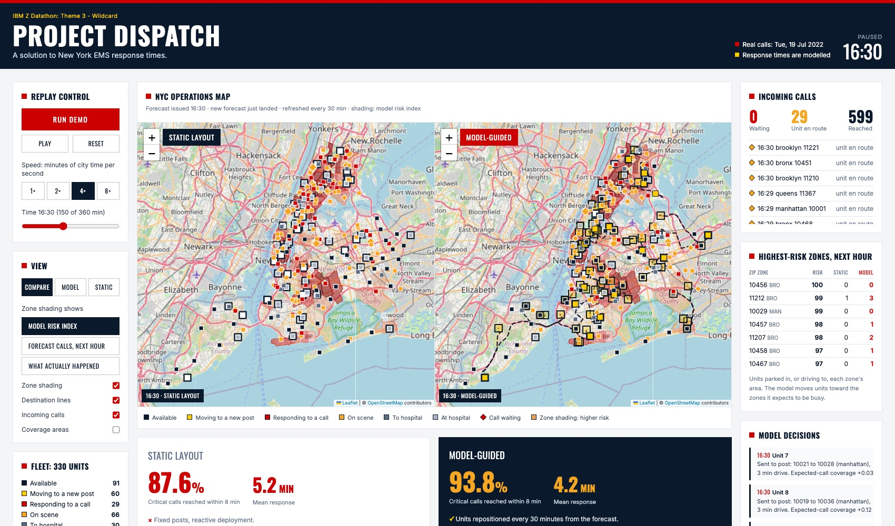

### B3. Where units are going after a decision
Model-guided view, zoomed. Dashed navy lines are the real street routes (OSRM) from a unit to the post the model chose; the gold square marks the destination, and moving units are gold. Hospitals are white squares. The red shading is the model's highest-risk zones.

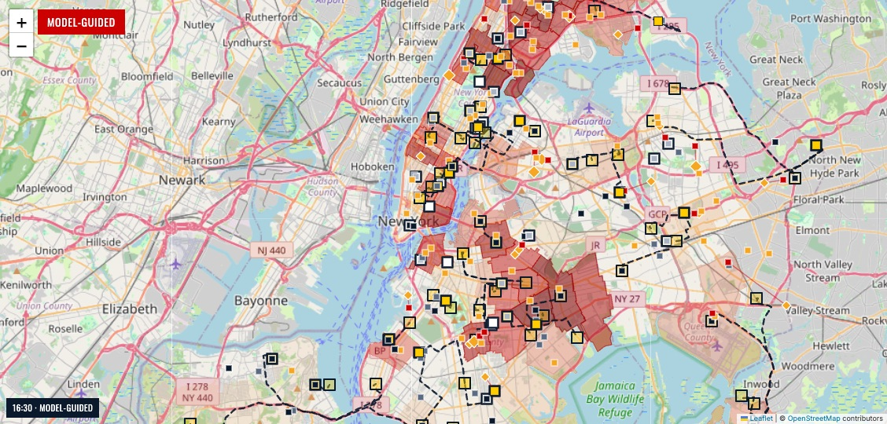

### B4. Zones changing with the model output (same moment, 17:30)
The same map shaded three ways: the model's risk index, the forecast calls for the next hour, and what actually happened. Comparing the second and third shows where the forecast was right and where it missed.

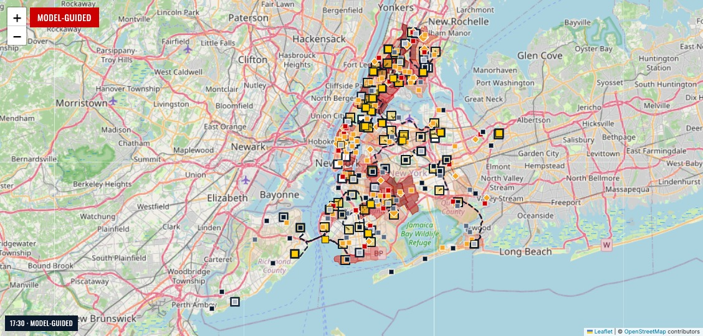
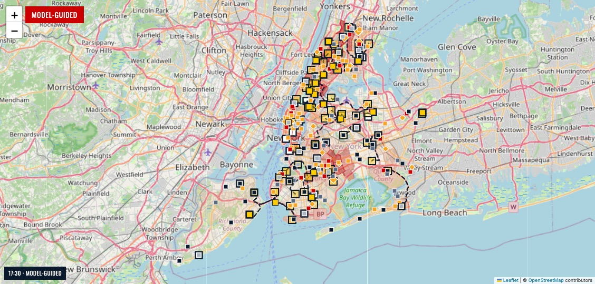
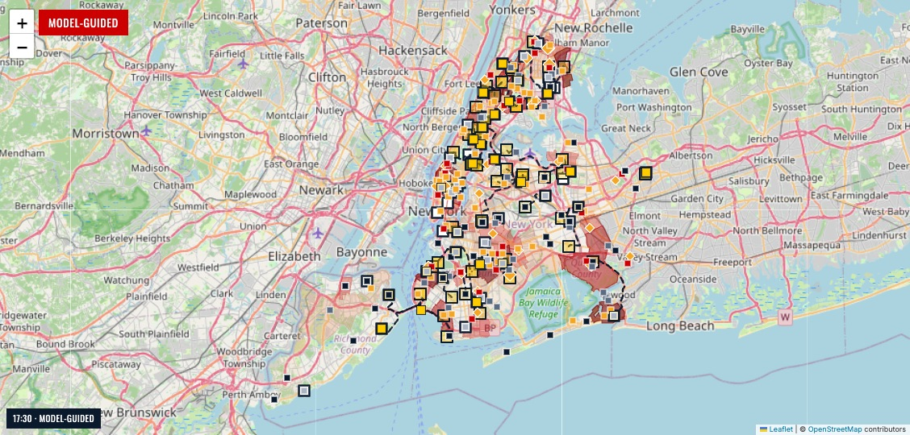

### B5. Calls, highest-risk zones and decision log
Close-up of the right-hand column at 17:20: the call feed (812 calls reached so far), the highest-risk zones with the number of units in or heading to each (static vs model), and each move with its reason and drive time.

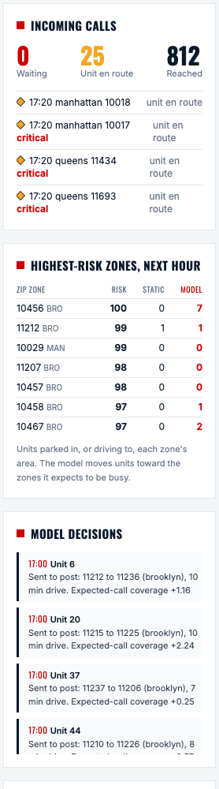

### B6. End of the replay: result tables
Running metrics for the 6-hour window, and the full-day result for static, model-guided and the oracle (82.3% → 91.2% → 93.4% of critical calls within 8 minutes).

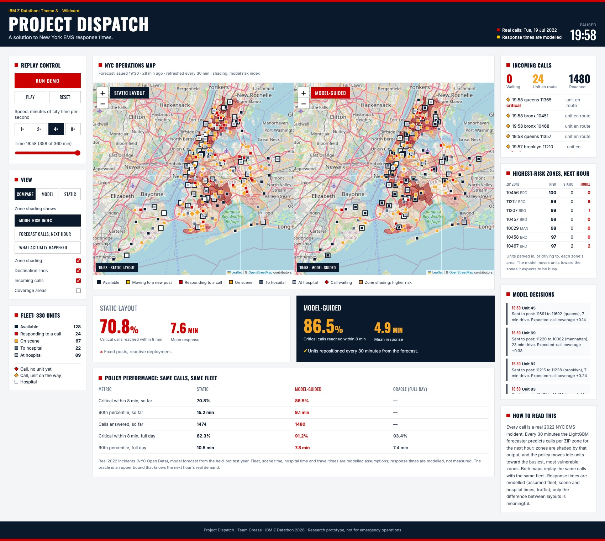

---

## C. Command output captured locally (real runs, rendered in a terminal-style frame)

### C1. Automated tests: 33 passed
Forecast features and model, risk index, routing policy, replay (including the trace used by the demo), street routing.

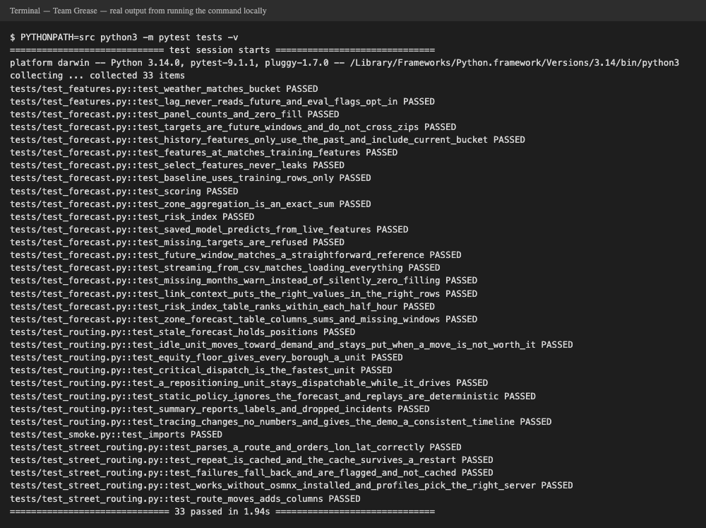

### C2. Demo export run
The replay of the heat-wave day for the three policies (4,694 incidents, 330 units), the borough breakdown, and the export of 1,508 window calls, 743 moves and 400 street routes. This is the run that produced the committed `demo.json` (output file path shortened).

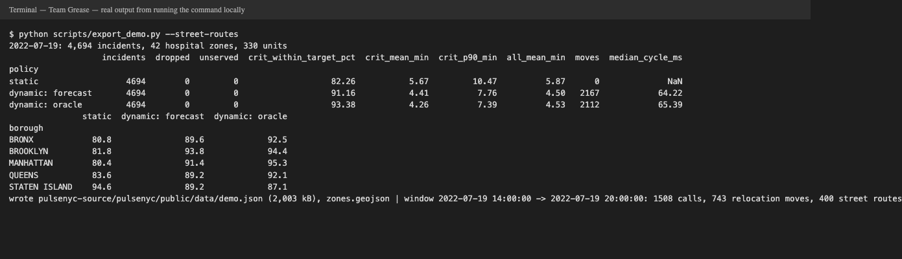

---
